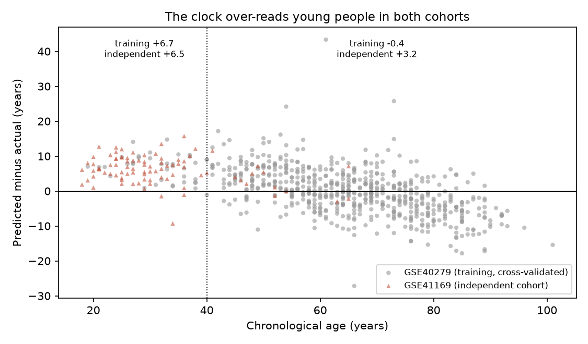

# epigenetic-clock

**A DNA methylation age clock reads an outside cohort almost six years too old. That looks like a transfer failure. It is not.**

Trained on 656 blood samples and tested on 89 from a different country and laboratory, the clock predicts ages **5.95 years too high** on average. The obvious conclusion is that clocks do not survive a change of lab. Checking the clock against its own training cohort, split by age, says otherwise:

| Age band | Cohort | n | MAE (years) | Bias (predicted − actual) |
|---|---|---:|---:|---:|
| under 40 | training, cross-validated | 35 | 6.67 [5.51, 7.86] | **+6.67** |
| under 40 | independent | 75 | 6.78 [6.04, 7.57] | **+6.46** |
| 40 and over | training, cross-validated | 621 | 5.13 [4.80, 5.46] | −0.40 |
| 40 and over | independent | 14 | 4.17 [2.76, 5.80] | +3.23 |

The clock over-reads young people by about six and a half years **in both cohorts, by almost the same amount**. The independent cohort is young — 75 of its 89 samples are under 40, against 35 of 656 in training — so what looked like a cross-laboratory failure is mostly the clock regressing young people toward the mean age it was trained on, which is 64.



## What transfers and what does not

| | Training cohort (5-fold CV) | Independent cohort |
|---|---|---|
| MAE | 5.21 years [4.90, 5.54] | 6.37 years [5.69, 7.06] |
| Correlation with age | r = 0.892 | r = 0.920 |
| Bias | — | +5.95 years |

**Ranking transfers; calibration does not.** The correlation with true age is if anything slightly higher on the cohort the clock never saw, so the clock still orders people by age correctly. What fails is the absolute number, and it fails in a direction the training data predicts.

For scale, predicting the training cohort's mean age for every person gives an MAE of 32.74 years, so the clock is doing real work either way.


## Does the age range explain it?

Partly, but not by itself. Restricting the training cohort's cross-validated predictions to the independent cohort's age range (18 to 65) gives MAE 4.96 [4.52, 5.42], which is still better than the 6.37 seen on the independent cohort. Range restriction alone does not close the gap; the age-band table above is what explains it, because the bias is concentrated under 40 where the training data is thinnest.

## Age acceleration in schizophrenia: no evidence here

The independent cohort is 33 controls and 56 schizophrenia patients. Age acceleration (the residual after regressing predicted on chronological age within the cohort) differs by **+1.20 years [−0.37, +2.76]**, controls higher than patients. The interval includes zero, so this sample shows no difference, and the point estimate runs opposite to the usual claim in the literature. With 33 versus 56 people this is underpowered, and the strong age-dependent bias above makes the residual itself unreliable. It is reported because it was measured, not because it settles anything.

## Data

Public Illumina 450K methylation arrays from GEO, both whole blood:

| Role | Accession | n | Ages | Notes |
|---|---|---:|---|---|
| Train | [GSE40279](https://www.ncbi.nlm.nih.gov/geo/query/acc.cgi?acc=GSE40279) | 656 | 19 to 101 (mean 64) | Hannum et al. |
| Test | [GSE41169](https://www.ncbi.nlm.nih.gov/geo/query/acc.cgi?acc=GSE41169) | 89 | 18 to 65 (mean 31.3) | Dutch cohort; 6 samples the depositors marked `used_in_analysis: no` are dropped |

473,034 probes are present in both. The clock uses the 20,000 most variable in the training cohort, chosen without reference to age so the selection cannot leak the target. **No probe was missing from the test cohort**, so nothing had to be filled in and any transfer failure is a genuine one rather than absent measurements.

## Method

- Elastic net (l1_ratio 0.5) with the penalty chosen by inner cross-validation; 454 probes receive non-zero weight.
- Within-cohort performance is 5-fold cross-validated, never in-sample.
- Every clock is compared against predicting the training mean age, because a model that cannot beat that is worthless however good its correlation looks.
- Intervals are 95% bootstrap intervals over samples.
- Horvath's logarithmic age transform is implemented but off by default: both cohorts are adults, so it is not needed, and leaving it off keeps one fewer moving part.

## Run

```bash
python3 -m venv .venv && .venv/bin/pip install -r requirements.txt
mkdir -p data/raw && cd data/raw
curl -O https://ftp.ncbi.nlm.nih.gov/geo/series/GSE40nnn/GSE40279/matrix/GSE40279_series_matrix.txt.gz
curl -O https://ftp.ncbi.nlm.nih.gov/geo/series/GSE41nnn/GSE41169/matrix/GSE41169_series_matrix.txt.gz
cd ../.. && .venv/bin/python scripts/run_clock.py      # writes results/
.venv/bin/python -m pytest tests -q
```

The download is about 1.4 GB and the first run caches the prepared matrices, so later runs skip it. Tests use a small synthetic series matrix, clearly marked as fake, and check the parser against the quirks of real GEO files (missing values written as `NA`, `null` or an empty field; age buried in any characteristics line; samples without an age).

## Limits

Two cohorts, one tissue, one array platform, one country each. The clock is a quick elastic net on the most variable probes, not a careful reproduction of a published clock, and its within-cohort MAE of 5.21 years is worse than the roughly 3.6 to 3.9 years reported for the Horvath and Hannum clocks. Only 35 training samples are under 40, which is the direct cause of the main finding and also means that finding rests on few people. Nothing here says anything about whether an epigenetic clock measures biological ageing rather than a correlate of it.

## References

Hannum, G. et al. (2013). Genome-wide methylation profiles reveal quantitative views of human aging rates. *Molecular Cell*. Data: GEO GSE40279.

Horvath, S. et al. (2012). Aging effects on DNA methylation modules in human brain and blood tissue. Data: GEO GSE41169.

## Licence

Code: MIT. Data: from GEO, under the terms of the original depositors.
