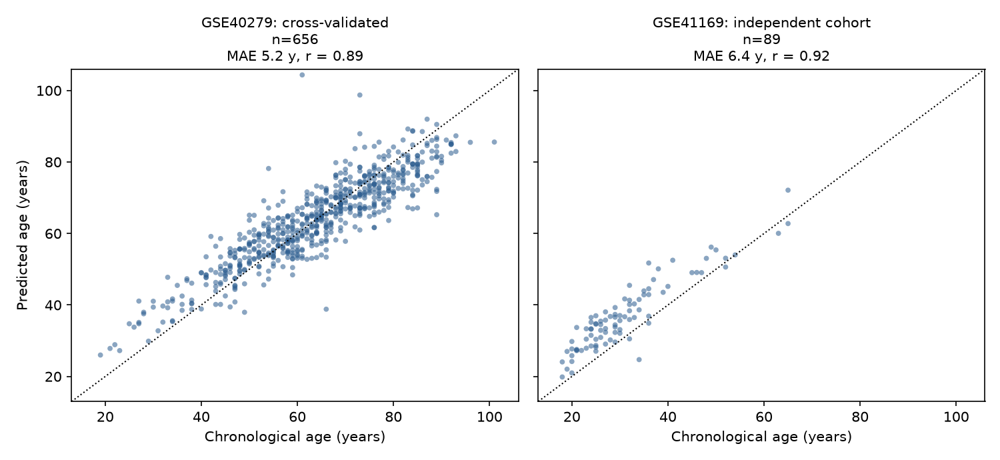
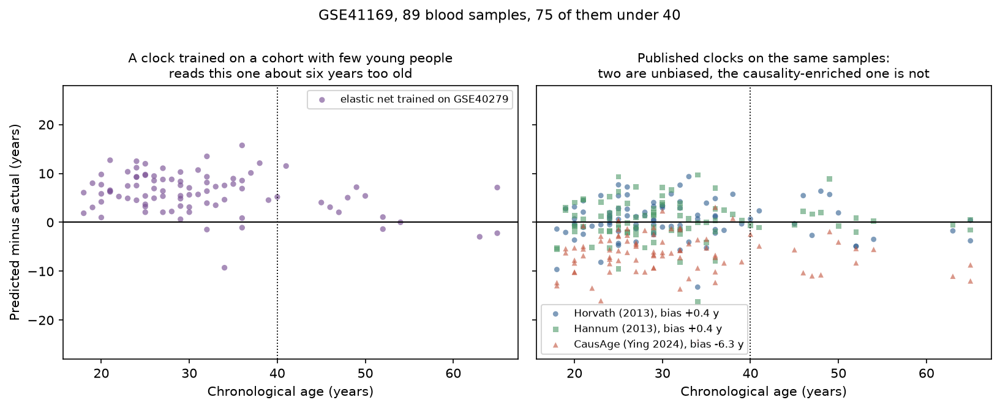

# epigenetic-clock

**A DNA methylation age clock reads an outside cohort almost six years too old. That looks like a transfer failure. It is not.**

Trained on 656 blood samples and tested on 89 from a different country and laboratory, the clock predicts ages **5.95 years too high** on average. The obvious conclusion is that clocks do not survive a change of lab. Checking the clock against its own training cohort, split by age, says otherwise:

| Age band | Cohort | n | MAE (years) | Bias (predicted − actual) |
|---|---|---:|---:|---:|
| under 40 | training, cross-validated | 35 | 6.67 [5.51, 7.86] | **+6.67** |
| under 40 | independent | 75 | 6.78 [6.04, 7.57] | **+6.46** |
| 40 and over | training, cross-validated | 621 | 5.13 [4.80, 5.46] | −0.40 |
| 40 and over | independent | 14 | 4.17 [2.76, 5.80] | +3.23 |

The clock over-reads young people by about six and a half years **in both cohorts, by almost the same amount**. The independent cohort is young — 75 of its 89 samples are under 40, against 35 of 656 in training — so what looked like a cross-laboratory failure is mostly the clock regressing young people toward the mean age it was trained on, which is 64.


## What transfers and what does not

| | Training cohort (5-fold CV) | Independent cohort |
|---|---|---|
| MAE | 5.21 years [4.90, 5.54] | 6.37 years [5.69, 7.06] |
| Correlation with age | r = 0.892 | r = 0.920 |
| Bias | — | +5.95 years |

**Ranking transfers; calibration does not.** The correlation with true age is if anything slightly higher on the cohort the clock never saw, so the clock still orders people by age correctly. What fails is the absolute number, and it fails in a direction the training data predicts.

For scale, predicting the training cohort's mean age for every person gives an MAE of 32.74 years, so the clock is doing real work either way.



## Does the age range explain it?

Partly, but not by itself. Restricting the training cohort's cross-validated predictions to the independent cohort's age range (18 to 65) gives MAE 4.96 [4.52, 5.42], which is still better than the 6.37 seen on the independent cohort. Range restriction alone does not close the gap; the age-band table above is what explains it, because the bias is concentrated under 40 where the training data is thinnest.

## Age acceleration in schizophrenia: no evidence here

The independent cohort is 33 controls and 56 schizophrenia patients. Age acceleration (the residual after regressing predicted on chronological age within the cohort) differs by **+1.20 years [−0.37, +2.76]**, controls higher than patients. The interval includes zero, so this sample shows no difference, and the point estimate runs opposite to the usual claim in the literature. With 33 versus 56 people this is underpowered, and the strong age-dependent bias above makes the residual itself unreliable. It is reported because it was measured, not because it settles anything.

## Is this true of clocks in general? No.

The obvious next question is whether any clock that regresses on chronological age does this.
`scripts/run_published_clocks.py` answers it by running six published clocks on the same two
cohorts, using coefficients and transforms from `biolearn` so each is applied as its authors
defined it. Nothing is fitted here: these are published weights on data they did not see. All six
clocks have 100% of their CpGs present in both cohorts, so no result rests on imputed sites.

**On the independent cohort, GSE41169, 89 samples with 75 under 40:**

| Clock | Slope | Bias | Bias under 40 | r |
|---|---:|---:|---:|---:|
| Horvath (2013) | 0.99 | **+0.43** | +0.50 | 0.936 |
| Hannum (2013) | 1.00 | **+0.41** | +0.36 | 0.931 |
| CausAge (Ying 2024) | 0.96 | **−6.33** | −6.16 | 0.921 |
| the elastic net above | — | **+5.95** | +6.46 | 0.920 |

Horvath and Hannum read this cohort almost exactly right. **So the six-year error above is a
property of this clock and the cohort it was trained on, not of age-regressed clocks in general**,
and the claim should not be widened beyond that. A clock trained where only 35 of 656 samples are
under 40 reads young people badly; clocks trained across a wider age range do not.

The second row of the table is the one worth keeping. **CausAge, built from CpGs selected by
epigenome-wide Mendelian randomisation, is the worst calibrated of the three on this cohort**, and
it is off in the opposite direction. Ying et al. showed that existing clocks are not enriched for
causal sites and built ones that are, which changes what a clock measures. On this evidence it
does not change how it calibrates, so causal enrichment and calibration look like separate
problems.

On the training cohort, which spans 19 to 101, every clock compresses toward the middle: slopes
run 0.50 to 0.84, CausAge among them at 0.76. Compression is general. What it does to the bias at
test time depends on the age range of the cohort you apply it to, which is why it shows up here
and not in Horvath or Hannum.



**Limits of this comparison.** GSE40279 is Hannum's own training cohort, so Hannum's numbers there
are not out-of-sample and must not be read as such. PhenoAge predicts phenotypic rather than
chronological age, so its negative bias is expected and is not a defect. DamAge and AdaptAge are
not chronological-age predictors at all (r = 0.66), so a bias in years is not a meaningful summary
of them, and they are reported only because they were run. 190 of roughly 290,000 test beta values
were missing and filled with the training mean. One cohort pair, one platform, one tissue.

## Which of these CpGs can Mendelian randomisation speak to at all?

Before asking whether a clock is built from causal sites, there is a prior question with a factual
answer: do its CpGs have genetic instruments? `scripts/fetch_mqtls.py` pulls cis-mQTLs from
[GoDMC](http://api.godmc.org.uk) (Min et al., Nature Genetics 2021) at p < 5e-8, which is public
and needs no account, and `scripts/instrument_strength.py` summarises them.

| Clock | CpGs | Instrumented | **Unassessable** | Median instruments | Median best F | Selection |
|---|---:|---:|---:|---:|---:|---|
| Horvath (2013) | 353 | 57.8% | **42.2%** | 1 | 285 | methylation only |
| Hannum (2013) | 71 | 71.8% | **28.2%** | 1 | 306 | methylation only |
| PhenoAge | 513 | 55.2% | **44.8%** | 1 | 357 | methylation only |
| CausAge | 585 | 100.0% | 0.0% | 2 | 694 | MR-selected |
| DamAge | 1089 | 100.0% | 0.0% | 2 | 823 | MR-selected |
| AdaptAge | 999 | 100.0% | 0.0% | 2 | 793 | MR-selected |

**The 100% is not a finding.** Epigenome-wide MR can only select CpGs that have instruments, so
those three columns had to come out that way, and the run is a check that the pipeline does what
it is meant to rather than evidence of anything. Had they come out lower, I would have
misunderstood how those clocks were built.

The informative column is the one next to it. **Between 28% and 45% of the CpGs in the
conventional clocks have no genome-wide significant cis-mQTL**, so MR cannot say anything about
them in either direction. That is absence of evidence, not evidence that a site is not causal, and
it bounds what a comparison of causal enrichment between these clocks can mean: it can only be a
comparison over the assessable part, which is all of one set and roughly 60% of the other.

An F threshold is reported in the script output only to show it does nothing here. Instruments
pulled at p < 5e-8 already have F near 30 or above, so a weak-instrument filter at F > 10 excludes
nothing and should not be presented as though it had.

Taken with the calibration result above, the picture is consistent: the MR-selected clock has
strictly better instruments, roughly twice the median best F, and calibrated worse on the
independent cohort. Causal selection bought one thing and not the other.

**This is the exposure half of an MR, not an MR.** Nothing here estimates an effect of methylation
on anything. That needs outcome GWAS summary statistics, and the obvious source, OpenGWAS, has
required an access token since 1 May 2024.

## Data

Public Illumina 450K methylation arrays from GEO, both whole blood:

| Role | Accession | n | Ages | Notes |
|---|---|---:|---|---|
| Train | [GSE40279](https://www.ncbi.nlm.nih.gov/geo/query/acc.cgi?acc=GSE40279) | 656 | 19 to 101 (mean 64) | Hannum et al. |
| Test | [GSE41169](https://www.ncbi.nlm.nih.gov/geo/query/acc.cgi?acc=GSE41169) | 89 | 18 to 65 (mean 31.3) | Dutch cohort; 6 samples the depositors marked `used_in_analysis: no` are dropped |

473,034 probes are present in both. The clock uses the 20,000 most variable in the training cohort, chosen without reference to age so the selection cannot leak the target. **No probe was missing from the test cohort**, so nothing had to be filled in and any transfer failure is a genuine one rather than absent measurements.

**What this repository used to contain.** Until this rewrite there was no real data here at all. A
`MethylationCohortGenerator` invented beta values for 500 fictional donors across five tissues, and
the README reported its output as findings: a multi-tissue clock at MAE 7.13 years and r = 0.945, 35
loci mapped to named genes and pathways, and a Yamanaka (OSKM) reprogramming benchmark showing a
12-year age reversal and 98.4% rejuvenation in iPSCs. None of it was measured. The simulator, the
reprogramming module, the interpretability module and all four figures are deleted, and every number
above comes from the two GEO cohorts named in the table. The earlier version is still in the commit
history, at `252d6f3`.

## Method

- Elastic net (l1_ratio 0.5) with the penalty chosen by inner cross-validation; 454 probes receive non-zero weight.
- Within-cohort performance is 5-fold cross-validated, never in-sample.
- Every clock is compared against predicting the training mean age, because a model that cannot beat that is worthless however good its correlation looks.
- Intervals are 95% bootstrap intervals over samples.
- Horvath's logarithmic age transform is implemented but off by default: both cohorts are adults, so it is not needed, and leaving it off keeps one fewer moving part.

## Run

```bash
python3 -m venv .venv && .venv/bin/pip install -r requirements.txt
mkdir -p data/raw && cd data/raw
curl -O https://ftp.ncbi.nlm.nih.gov/geo/series/GSE40nnn/GSE40279/matrix/GSE40279_series_matrix.txt.gz
curl -O https://ftp.ncbi.nlm.nih.gov/geo/series/GSE41nnn/GSE41169/matrix/GSE41169_series_matrix.txt.gz
cd ../.. && .venv/bin/python scripts/run_clock.py      # writes results/
.venv/bin/python -m pytest tests -q
```

The download is about 1.4 GB and the first run caches the prepared matrices, so later runs skip it. Tests use a small synthetic series matrix, clearly marked as fake, and check the parser against the quirks of real GEO files (missing values written as `NA`, `null` or an empty field; age buried in any characteristics line; samples without an age).

## Limits

Two cohorts, one tissue, one array platform, one country each. The clock is a quick elastic net on the most variable probes, not a careful reproduction of a published clock, and its within-cohort MAE of 5.21 years is worse than the roughly 3.6 to 3.9 years reported for the Horvath and Hannum clocks. Only 35 training samples are under 40, which is the direct cause of the main finding and also means that finding rests on few people. Nothing here says anything about whether an epigenetic clock measures biological ageing rather than a correlate of it.

## References

Hannum, G. et al. (2013). Genome-wide methylation profiles reveal quantitative views of human aging rates. *Molecular Cell*. Data: GEO GSE40279.

Horvath, S. et al. (2012). Aging effects on DNA methylation modules in human brain and blood tissue. Data: GEO GSE41169.

## Licence

Code: MIT. Data: from GEO, under the terms of the original depositors.
